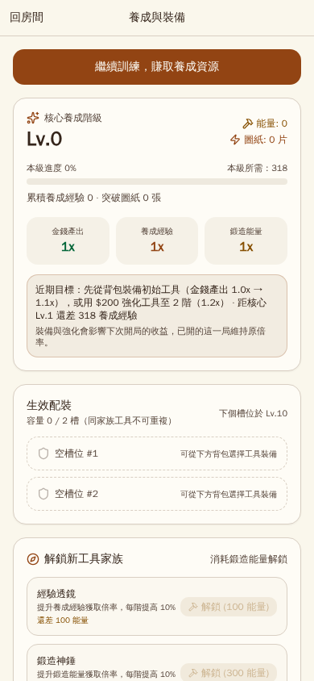
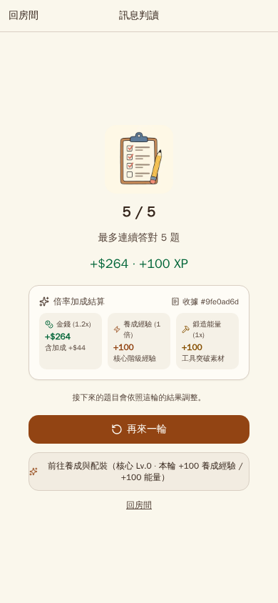
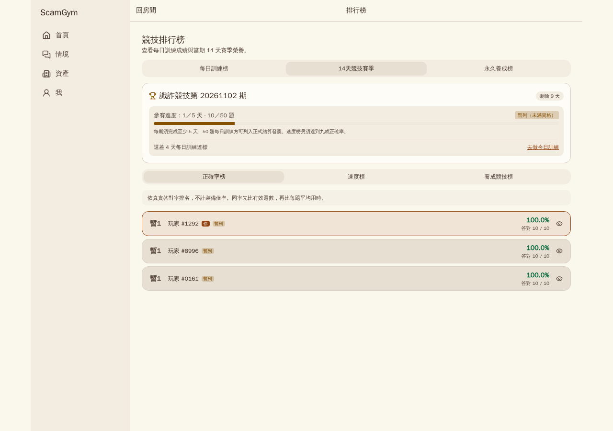

# ScamGym 完整驗收與遊戲性報告

日期：2026 年 11 月 6 日。交付識別：20261106-verified。數值設定：growth-v1.1。分支：codex/gameplay-v1-ready。

## 1. 完成結果

本版保留原題目、題組、正解、判分及答題揭曉流程，在既有作答後接上永久養成、有限配裝、兩週競技與收藏展示。普通玩家能取得資源、做出有作用的成長選擇，再帶著新倍率進入下一局。

最終展示網址為 http://localhost:17173 。一般玩家登入資訊另存桌面「ScamGym本機登入.txt」，密碼與 API 金鑰不放入程式包。雙擊 start-gameplay.cmd 可啟動。深度評估在獨立 http://localhost:18173 執行，與展示站資料卷分開；完成後評估堆疊停止、資料保留，展示站恢復運行。

已完成後端 1222 項、前端 245 項、完整瀏覽器 67 項、背景遊玩 535 項檢查，以及分析數學 2 項測試。另通過 mypy 103 個來源檔、Ruff、格式檢查、前端六檔 Biome、SDK 重生比對、獨立收據稽核與建置快取五項邊界檢查。詳細證據附於本報告後方及 verification 資料夾。

本次以實際程式、正常起始資源與可回查紀錄評估遊玩閉環；成長輪數是實跑結果，超過觀測範圍的回本與閱讀時間是假設推算。沒有把自動作答寫成真人留存或教育成效研究。

## 2. 已加入的遊戲性與獎勵

| 項目 | 實際行為與價值 |
| --- | --- |
| 三通道養成 | 原玩法結算帶來金錢、獨立養成經驗與鍛造能量。原訓練經驗仍用於原功能解鎖，沒有混成養成等級。 |
| 核心指數成長 | 核心每級倍率為 (6/5)^n，也就是 1.2^n；可持續放大後續養成產出。 |
| 防禦金庫 | 每階增加 10% 金錢通道倍率；起始即贈一件一階工具，裝備後才生效。 |
| 經驗透鏡 | 消耗 100 能量解鎖，每階增加 10% 養成經驗倍率。 |
| 鍛造神錘 | 消耗 300 能量解鎖，每階增加 10% 能量倍率。 |
| 平衡核心 | 消耗 800 能量解鎖，每階對三通道增加 5%。 |
| 連勝擴大器 | 消耗 2000 能量解鎖，當輪最佳連勝至少三題時，每階對三通道增加 6%。 |
| 競賽紋章 | 消耗 5000 能量解鎖，每階增加 10% 養成競技加成，不影響真實正確率與速度榜。 |
| 有限生效槽 | 起始兩槽，核心 10／25／45 級增加至三／四／五個常規槽；同家族不可重複生效。永久額外槽許可在核心 25 級與 40 片圖紙達標後增加一槽，總上限六槽。 |
| 強化與逐階突破 | 首次強化消耗 200 金錢，下一階 1200；一般上限五階，突破每次提高一階，最高八階，需對應圖紙／票券與能量。沒有一次點擊跳到最高階。 |
| 配裝保存 | 起始兩個保存欄，可擴充到五欄；每次仍只有一套生效。保存不額外堆疊倍率，套用仍檢查所有權、家族與槽位。 |
| 房屋長期建設 | 累積建設等級與永久地位。原房價、租金與購買解鎖規則保持原樣。 |
| 寵物羈絆 | 展示中的寵物每級使養成倍率提高 1%，上限兩倍；首級消耗 500 金錢與 10 能量，並增加寵物收藏地位。 |
| 三個永久榜 | 累積訓練所得、房屋建設、寵物收藏。消費不降低累積所得，退款與變賣不灌高訓練所得，同類收藏不重複灌分。 |
| 十四天競技 | 正確率、速度、養成競技三榜；正式發獎資格至少五天、五十題每日訓練，速度榜另須九成正確率。 |
| 當期與永久價值分層 | 真實作答能力留在當期技能榜，房屋、寵物、工具與榮譽跨期保留。暫列與正式資格分開顯示，同分可以同名次。 |
| 排名獎勵 | 冠軍可永久領取六階工具選擇權；名次獎勵含養成素材與永久榮譽。跨榜只領最佳能力獎勵一次，各榜榮譽仍保留，避免三榜重複膨脹同一筆材料。 |
| 展示與公開名片 | 獎盃、稱號、寵物外觀與房間展示櫃讓成果可見，也能查看其他玩家的公開成長資料；私人背包、電子郵件與密碼雜湊不對外列出。 |
| 自動關帳 | 獨立 season-worker 關帳，不必等待玩家請求；凍結結果、續跑、防重送與並行保護均納入後端驗證。 |
| 新手近期目標 | 起始明示免費配裝、200 金錢強化與核心一級差額；依已擁有工具與空槽提出下一步，已解鎖工具不再叫玩家重買。 |
| 結算後成長入口 | 結算展示本輪養成經驗、能量與核心變化，直接連到養成與配裝。每日訓練仍維持每天一次，沒有新增可刷的再來一輪。 |
| 可負擔提示 | 先顯示缺少的金錢、能量或圖紙，資源不足時停用按鈕，避免按下才看到籠統錯誤。 |
| 精確與可信的獎勵 | 開局鎖定倍率、當局不受中途換裝影響；收據、資源流水與錢包同交易保存。大數使用十進位字串與精確整數運算，資料庫為 NUMERIC(78,0)。 |
| 情境現金對帳 | 情境原本的固定現金獎勵記入收據與累積所得；現金有效倍率為 1.0，不改原獎懲金額，也不重複發現金。 |

本版沒有改題目、題組或新增更難題庫。更難題挑戰權與三四題收手冒險模式仍放在先前設計構想中，不混入本次已實作清單。

## 3. 成長率與定價

核心倍率是指數 1.2^n。第 n 級的升級參考時間參數為 6+2n，經驗成本為 ceil(40 × (6+2n) × 1.2^n × 1.15^常規槽數)，總門檻是逐級成本累加。第一級成本 318 養成經驗。

上述分鐘參數是定價參考，40 經驗／分鐘與參考配裝不是本次測出的真人速度。實際節奏以以下正常輪數判斷。工具現金強化價格為 200 × 6^(目前階級-1)，因此一到二階為 200、二到三階為 1200；本次未為了通過評估修改這些數值。

原訓練等級五需要 1000 訓練經驗。已修正先前把 400 經驗當成等級五的畫面與測試；原等級表沒有改動。四成正確玩家十輪為 400 經驗、訓練等級三，不會被假裝解鎖每日訓練。

## 4. 普通玩家實跑結果

三帳號均從 1000 金錢、零養成經驗、零能量起步。每輪沿用原五題題組，答案由原 API 判定；測試以唯讀真值控制正確率，不直接寫入對錯或補資源。以下是各十輪、各五十題後的狀態，不含之後的換裝、每日訓練與情境擴充流程。

| 表現 | 答對／總題數 | 首次強化輪 | 第二家族輪 | 首次寵物輪 | 首次核心升級輪 | 十輪現金 | 十輪養成經驗 | 十輪能量 | 十輪等級 |
| --- | --- | --- | --- | --- | --- | --- | --- | --- | --- |
| 全對 | 50/50 | 1 | 1 | 2 | 3 | 3497 | 1330 | 1110 | 核心 2／訓練 5 |
| 七成正確 | 35/50 | 1 | 2 | 1 | 5 | 2320 | 831 | 658 | 核心 2／訓練 4 |
| 四成正確 | 20/50 | 1 | 3 | 1 | 8 | 1292 | 446 | 306 | 核心 1／訓練 3 |

首次強化在第零輪就能負擔，腳本選擇在第一輪結束後操作，兩者已分開記錄。第三家族的 300 能量可負擔時間分別為第四、六、十輪。三類玩家均在前三輪完成有作用的養成，四成正確玩家也沒有陷入負債或無法繼續訓練的斷點。

### 4.1 收益差額與回本

下表固定每輪實際基礎獎勵、開局核心與寵物快照，比較有無該次強化的精確取整差額。這是對實測快照的可回算分析，不是兩批真人的隨機對照實驗。十輪以外的數字另標外推，不將它們寫成已實跑。

| 表現 | 金庫升二階十輪累計差額 | 觀測內成本 200 結果 | 固定狀態外推 | 寵物首級十輪現金差額 | 寵物經驗差額 | 寵物能量差額 |
| --- | --- | --- | --- | --- | --- | --- |
| 全對 | 244 | 第 9 輪跨過 200 成本 | 不需要外推 | 23 | 8 | 8 |
| 七成正確 | 152 | 十輪內未跨過 200 成本 | 第 13 輪（固定後兩輪平均差額） | 13 | 2 | 0 |
| 四成正確 | 76 | 十輪內未跨過 200 成本 | 第 23 輪（固定後兩輪平均差額） | 2 | 2 | 0 |

寵物的價值包含永久收藏地位；不能把 1% 倍率宣稱為每輪一定多出一點整數資源。低基礎收益下會被向下取整，七成與四成玩家的前十輪沒有額外整數能量。既有柴犬從羈絆零級升一級，收藏分數從 100 到 110，增加的是 10 分。已修正先前將這段寫成增加 110 分的分析文案。

### 4.2 有限槽的實際取捨

同一普通玩家先把兩槽裝上金庫與透鏡，解鎖第三家族後，畫面確實拒絕在滿槽時加入第三件。接著卸下透鏡、裝上神錘並重載，資料庫與畫面都維持兩槽。

在換裝前開出的舊局仍用原透鏡快照，收益為金錢 383、養成經驗 159、能量 145。下一局改用神錘快照，收益為金錢 383、養成經驗 145、能量 159。玩家能依想加速核心或工具養成而換裝，保存配裝不會額外疊加收益。

### 4.3 每日訓練、暫列與真實情境

全對玩家透過十輪原題組達到 1000 訓練經驗及等級五，再完成十題每日訓練；當期顯示一天／五天、十題／五十題，維持暫列而非正式發獎資格。位置從實際 API 讀取，沒有要求每次測試都排名第一。

同一正常成長帳號另外呼叫真實 Gemini，取得 2 段回覆，玩家回合數持久化為 1。原規則裁決為 win_trust，本次原現金獎勵 800，額外現金倍率獎勵 0；收據、錢包與累積所得一致。重送裁決回 400，資源不再增加。

### 4.4 時間怎樣讀

CSV 的 pure_api_ms 使用瀏覽器 request timing，只統計發牌、逐題作答與結算的主要 API；ui_action_ms 是相關控制與導航時間扣除這些請求耗時。script_round_ms 計到本輪結算畫面，包含測試資料查核，不包含之後的養成操作。這些不是人類讀題速度。

閱讀欄位分別用每秒 18／12／8 字，加每題 3／4／6 秒作快速、一般與仔細閱讀假設，主要計題幹及選項，不含完整揭曉停留。若用來排真人場次，需另外加入閱讀揭曉、思考與休息時間。

## 5. 畫面與程式的對照方式

背景無頭瀏覽器操作實際 Nginx 頁面，以可見文字及角色定位控制項，沒有 mock 成功回應。正常流程的進度只由原 API 產生，SQL 只查詢。測試帳號／種子與前後端單元測試的受控夾具分開。

| 流程 | 實作與查核位置 |
| --- | --- |
| 原題組 | frontend/src/routes/_shell/quick/quiz.tsx、useQuiz；backend/app/api/routes/quick.py、quiz_session |
| 結算與倍率 | QuizSummary、RewardBreakdown；progression/service.py、math.py、reward_context、reward_receipt、progression_ledger |
| 配裝與強化 | progression.tsx、useEquipment；equipment 路由、player_equipment、equipment_loadout |
| 長期收藏 | LongTermGrowth、RoomScene／RoomStage；collections.py、collection_growth、player_collectible、loadout_preset |
| 競技 | leaderboard.tsx、useSeasons；seasons.py、competition_entry、season_final_row、season_award |
| 真實情境 | scenario 路由、scenario/agent.py；scenario_session 的回合、對話與確定性裁決 |

| 保存步驟 | 關聯局次 | 證據 |
| --- | --- | --- |
| 1_room_initial | 見 JSON 該步驟 | 畫面、真實請求或 DB 快照已保留 |
| 2_progression_initial | 見 JSON 該步驟 | 畫面、真實請求或 DB 快照已保留 |
| 3_equip_and_upgrade_starter_tool | 見 JSON 該步驟 | 畫面、真實請求或 DB 快照已保留 |
| 4_and_5_quiz_round_and_settlement | 6f51ed86-eadb-4e14-86dc-1aeba2cda87e | 畫面、真實請求或 DB 快照已保留 |
| 6_play_again_new_session | 3e71ae9f-9fe6-4706-92d8-c4a409ba515e | 畫面、真實請求或 DB 快照已保留 |
| 7_leaderboard_views | 見 JSON 該步驟 | 畫面、真實請求或 DB 快照已保留 |

每個局次與收據 ID、倍率、資源及操作前後快照均可在 evaluation-final-20261106.json 查回。獨立稽核又從 PostgreSQL 取出三十張收據重新驗算，三十輪全數一致。

## 6. 原定 AC1–AC8 驗收

| 項目 | 本輪證據與結果 |
| --- | --- |
| AC1 近期目標 | 起始免費配裝、200 強化與核心一級 318 缺口可見；已擁有但未裝備的工具不再要求購買。通過。 |
| AC2 三輪內有感養成 | 三類玩家第一輪後強化，第二家族在一／二／三輪後取得，下一局有實際倍率。通過。 |
| AC3 結算接下一步 | 本輪養成資源與前往配裝入口可操作；每日結算沒有再來一輪。通過。 |
| AC4 資源與按鈕 | 起始不足 100 能量、寵物不足 10 能量、升三階不足 400 金錢均有提示與停用；直接不足資源 API 不扣款。通過。 |
| AC5 精確一致 | 整數倍率、錢包、經驗、能量、收據、流水、重新整理及情境固定現金對帳一致。通過。 |
| AC6 中低表現可持續 | 七成與四成玩家十輪均有成長、工具及可負擔選項，沒有負債斷點。通過。 |
| AC7 資格與地位 | 每日訓練原門檻 1000 XP，技能榜與永久榜分開，當期依實際未達資格狀態顯示暫列。通過。 |
| AC8 異常與重送 | 沒有未處理前端錯誤；刻意負向探針分類記錄；開局快照不可被改寫、結算及裁決重送不重複領獎。通過。 |

## 7. 本輪修正前後

| 問題 | 完成的處理 |
| --- | --- |
| 基線 JSON 存入登入 token | 登入回應不留 token，遞迴遮蔽憑證與錯誤字串，既有基線清理；交付另做掃描。 |
| 只記錄而不判定失敗 | 加入硬斷言、精確運算與 DB 對帳；出錯非零結束。 |
| 點擊後等固定毫秒便算升級 | 等實際 HTTP 成功、DB 扣款／階級與畫面更新，再記里程碑。 |
| 400 XP 被誤當訓練五級 | 恢復按原 1000 門檻及 API 的 level 判斷，畫面缺口正確，沒有改原等級表。 |
| 把讀取不到的快照當空配裝 | 使用真實 equipment_snapshot 欄位。 |
| 回題組時讀到另一局 | 舊局留在原分頁，另一分頁換裝，再分別驗證舊局與新局。 |
| 猜錯排行榜路徑與欄位 | 改用真實 /boards/accuracy、my_entry、is_qualified，按實際名次核對。 |
| 只驗證槽滿，沒有真的交換 | 完成卸下、加入第三家族、重載與新舊局收益比較。 |
| 回本是手填文案 | 使用逐輪基礎值與快照計算精確差額；免費一階與付費二階分開，推算另列。 |
| 失敗後前面成果消失 | 每階段／輪次保存遮蔽檢查點與失敗報告，保留歷史，不冒充成功。 |
| 遠期目標遮住眼前選擇 | 新手近期目標、結算後入口、已擁有工具判斷與可負擔提示。 |
| 情境現金有入帳但收據／所得漏記 | 原現金進收據與所得，有效現金倍率 1.0；原獎懲與判分不變，重送不加第二次。 |
| 每次啟動都重建、資源壓力 | 來源指紋及映像 ID 核對，符合即重用；本機單 worker、測試 test-stage，檢查依序執行。 |

## 8. 環境、資料與測試證據

PostgreSQL 17.6，經 Supavisor 連線；遷移版本 d4e5f6a7b8c9。題庫查得 practice 120、exam_message 80、exam_scenario 20、exam_tactics 10，查證題 34。原題庫、人格與裁決等 47 個受保護來源檔與原版本雜湊相同。沒有改用 SQLite。

| 檢查 | 結果 | 證據 |
| --- | --- | --- |
| 完整 PostgreSQL 後端 | 1222 通過，零失敗／跳過 | verification/backend-tests.txt、backend-tests.xml |
| 前端回歸 | 245 通過，零失敗，54 檔 | verification/frontend-tests.txt |
| 完整瀏覽器 | 67 通過，未使用自動重試 | verification/browser-tests.txt |
| 普通遊玩及真實情境 | 535 通過 | evaluation-final-20261106.json、rounds-final-20261106.csv |
| 分析邊界 | 2 通過，區分免費一階／付費二階與大整數取整 | verification/evaluation-math-tests.txt |
| 型別與風格 | mypy 103、Ruff、Python 格式、前端六檔 Biome 通過 | verification/type-check.txt 等 |
| API SDK | 從實際 OpenAPI 重生，十個生成檔一致 | verification/sdk-generation.txt |
| 獨立資源稽核 | 三十張 DB 收據、三十輪資源變動相符 | verification/independent-receipt-audit.json |
| 啟動快取 | 五項正／負檢查通過，來源或映像改變會拒絕重用 | verification/build-cache-tests.json |
| 受保護來源 | 47 檔未變 | verification/protected-content.json |
| 最終展示環境 | 啟動、登入、原資料保留與正式前端查驗通過 | verification/primary-delivery.json |

兩週自然時間與真人長期留存沒有偽造。期末凍結、材料去重、冠軍工具、並行、故障回滾及高階邊界由 PostgreSQL 整合測試與先前明確標示的加速夾具驗證；本次普通玩家曲線不使用那些加速資源。

### 8.1 Docker 恢復與建置來源

本次曾在記憶體壓力期間遇到 Docker API 500；一般重啟未完成，後續啟動卡在 Windows AF_UNIX 通訊檔。停止 Docker 後，將只含通訊檔的 run 與 docker-secrets-engine 目錄改名備份，確認新目錄為空再啟動。未還原出廠、刪除資料卷、刪除原帳號或 prune。引擎恢復為 29.2.1。同類啟動現象可參考 Docker 專案的 [問題紀錄](https://github.com/docker/desktop-feedback/issues/448)，本機是否成功以本次啟動與資料查核為準。

恢復期間鏡像倉庫連線曾重置，因此核對 uv.lock、根與後端 pyproject.toml、bun.lock、根與前端 package.json 六個依賴輸入，均與先前通過驗證的 Docker 依賴映像一致，再以其為基底重建最新應用層與正式前端。不是這次重新下載全部依賴的無快取建置。應用來源、鎖檔、映像 ID 與驗收結果一起保存，正常新環境仍可由原 Dockerfile 建立。

桌面交付另以原始 Dockerfile 完成正式建置與全套啟動，再次通過兩帳號資料保存、真實登入、手機養成頁、榜單與公開名片檢查。此最後建置使用既有依賴快取，不宣稱重新下載所有套件；目前執行中的映像 ID 另記在 verification/desktop-delivery.json。啟動完整輸出見 desktop-launch.txt，重新查驗見 desktop-verification.txt。

### 8.2 關鍵畫面

## 9. 重跑與交付

一般啟動：雙擊 start-gameplay.cmd。完整測試：powershell -NoProfile -ExecutionPolicy Bypass -File scripts/gameplay-docker.ps1 test。

背景曲線依 [評估計畫](gameplay-evaluation-plan.md) 先啟動 scamgym-play-eval，再執行 powershell -NoProfile -ExecutionPolicy Bypass -File scripts/run-gameplay-evaluation.ps1。每次使用新的執行名稱，保留前次成果；正常曲線不補資源、不改原題組。

報告、可重跑程式、非敏感 JSON／CSV、截圖、雜湊及驗收證據包含在桌面新版原始碼包。原有交付包與資料卷保留。本輪採分支提交，不合併或部署正式網站；精確提交識別見交付包的 source-manifest.json 與 Git 歷史。

## 附錄：全部背景檢查代碼

下表涵蓋 78 種代碼、共 535 次執行。重複次數主要來自三類玩家逐題／逐輪核對。每次的時間與實際數值可查 JSON 的 assertionsLog；下方保留程式原始敘述以便重跑定位。

| 檢查代碼 | 執行次數 | 結果 | 程式原始敘述 |
| --- | --- | --- | --- |
| AC1_NEAR_TERM_GOAL_VISIBLE | 1 | 通過 | Progression page shows actionable near-term goal (equip/upgrade starter tool + gap to Core Lv.1) |
| AC3_DAILY_ONE_PER_DAY_LIMIT | 1 | 通過 | Daily training settlement does not show '再來一輪' (preserves 1/day limit) |
| AC3_SETTLEMENT_NEXT_STEP_VISIBLE | 1 | 通過 | Settlement screen shows earned growth XP/energy and a direct link to /progression |
| AC4_PET_DISABLED_WITH_GAP | 1 | 通過 | Pet bond button is disabled at 0 energy and shows exact energy gap |
| AC4_UNLOCK_DISABLED_WITH_GAP | 1 | 通過 | Second tool family unlock button is disabled at 0 energy and shows '還差 100 能量' |
| AC4_UPGRADE_RANK3_DISABLED_WITH_GAP | 1 | 通過 | Rank 2->3 upgrade button ($1,200) is disabled when cash is $800 and displays '還差 $400' |
| AC7_DAILY_LOCKED_GUIDANCE | 1 | 通過 | Daily leaderboard tab explains Lv.5 requirement and exact 900 XP gap (1,000 - 100) with direct link to /quick/quiz |
| AC7_PERMANENT_BOARD_SEPARATE | 1 | 通過 | Permanent wealth board tracks lifetime_cash (264) separately from season competition board |
| AC7_PROVISIONAL_RANK_DISTINGUISHED | 1 | 通過 | After 1 day (10 questions) of daily training, player is unqualified (qualified=false) and UI displays '暫列（未滿資格）' and actual provisional position '暫1' |
| AC7_SEASON_UNQUALIFIED_GUIDANCE | 1 | 通過 | Season leaderboard tab shows 0/5 days, '未入榜' (never Rank #1), and direct next-step link |
| AC8_ZERO_CONSOLE_OR_PAGE_ERRORS | 1 | 通過 | Zero unexpected console.error or unhandled pageerror events across normal gameplay flow |
| DAILY_COMPLETE_200 | 1 | 通過 | Daily challenge complete returned 200 |
| DAILY_UNLOCKED_AT_LV5 | 1 | 通過 | Daily challenge unlocked at Training Lv.5 (>= 1,000 XP) and dealt 10 questions |
| EQUIP_HAMMER_HTTP_200 | 1 | 通過 | Equipping forge_hammer into slot 2 returned 200 |
| EQUIP_SLOT2_DB_COUNT | 3 | 通過 | DB equipment_loadout has 2 active items |
| EQUIP_SLOT2_HTTP_200 | 3 | 通過 | Loadout update for slot 2 returned 200 |
| EQUIP_STARTER_DB_SAVED | 1 | 通過 | Starter tool equipped in slot 0 in DB |
| EQUIP_STARTER_HTTP_200 | 1 | 通過 | Equip starter tool returned 200 |
| INIT_GROWTH_DB_ZERO | 1 | 通過 | New player PlayerGrowth initialized at Lv.0, 0 GXP, 0 energy |
| INIT_STARTER_TOOL_DB | 1 | 通過 | New player owns Rank 1 save_vault in DB |
| INIT_UI_CASH_1000 | 1 | 通過 | Room header displays 1,000 cash |
| INIT_USER_CASH_1000 | 1 | 通過 | New player starts with 1000 cash |
| INIT_USER_XP_0 | 1 | 通過 | New player starts with 0 training XP |
| INSUFFICIENT_RESOURCE_REJECTED_CLEANLY | 1 | 通過 | Insufficient cash/energy API probes return 400 with exact error codes and zero resource mutation |
| MATH_CASH_BONUS | 32 | 通過 | Receipt cash_bonus matches exact rational cash_total - base_cash |
| MATH_CASH_TOTAL | 32 | 通過 | Receipt cash_total matches exact rational floor(base_cash * M_c) |
| MATH_FORGE_ENERGY | 32 | 通過 | Receipt forge_energy matches exact rational floor(base_xp * M_p) |
| MATH_GROWTH_XP | 32 | 通過 | Receipt growth_xp matches exact rational floor(base_xp * M_x) |
| MID_ROUND_SNAPSHOT_IMMUTABLE | 1 | 通過 | Mid-round loadout change did NOT alter active session's frozen 1.2x multiplier |
| PARTB_BASE_REWARD_MATCH | 30 | 通過 | Round 1 base cash/xp match formula |
| PARTB_COMPLETE_200 | 30 | 通過 | Round 1 complete 200 |
| PARTB_DB_RECONCILIATION_POST_ACTION | 30 | 通過 | Round 1 DB balances and receipt count (1) match after actions |
| PARTB_DB_RECONCILIATION_PRE_ACTION | 30 | 通過 | Round 1 DB balances match exact cumulative ledger before actions |
| PARTB_INIT_EQUIP_200 | 3 | 通過 | Equipped starter save_vault before Round 1 |
| PARTB_NO_ERRORS_ACC_40 | 1 | 通過 | Profile acc_40 completed 10 rounds with zero console/page errors |
| PARTB_NO_ERRORS_ACC_70 | 1 | 通過 | Profile acc_70 completed 10 rounds with zero console/page errors |
| PARTB_NO_ERRORS_ALL_CORRECT | 1 | 通過 | Profile all_correct completed 10 rounds with zero console/page errors |
| PARTC_ECONOMY_LV5_AT_1000XP | 1 | 通過 | All-correct player reached_1000_XP and economy.level === 5 after 10 rounds |
| PARTC_ZERO_CONSOLE_ERRORS | 1 | 通過 | Slot tradeoff and daily qualification flow had zero console errors |
| PET_UPGRADE_BTN_ENABLED | 3 | 通過 | Pet bond button is enabled when affordable |
| PET_UPGRADE_DB_CASH_DELTA | 3 | 通過 | DB cash decreased by 500 |
| PET_UPGRADE_DB_ENERGY_DELTA | 3 | 通過 | DB forge_energy decreased by 10 |
| PET_UPGRADE_DB_LEVEL | 3 | 通過 | DB collection_growth pet level is 1 |
| PET_UPGRADE_HTTP_200 | 3 | 通過 | Pet upgrade API returned 200 |
| PLAY_AGAIN_NEW_SESSION_ID | 1 | 通過 | Clicking '再來一輪' issues a brand-new quiz session_id |
| PUBLIC_DECK_NO_ANSWER_LEAK | 5 | 通過 | Public quiz deck item does not leak answer fields before submission |
| QUIZ_ANSWER_STATUS | 175 | 通過 | Quiz answer returned 200 |
| QUIZ_COMPLETE_200 | 1 | 通過 | Quiz complete returned 200 |
| RELOAD_PRESERVES_LOADOUT_AND_FACTOR | 1 | 通過 | Page reload preserves equipped Rank 2 tool and 1.2x cash multiplier |
| REPLAY_COMPLETE_REJECTED_NO_DOUBLE_PAY | 1 | 通過 | Re-submitting quiz/complete returns 400 quiz_already_completed, leaves balances unchanged, and creates only 1 receipt |
| REWARD_CONTEXT_FROZEN_AT_DEAL | 1 | 通過 | RewardContext froze 1.2x cash multiplier when quiz deck was dealt |
| ROOM_HAS_PROGRESSION_BTN | 1 | 通過 | Room displays progression entry button |
| SCENARIO_ACTIVE | 1 | 通過 | Original scenario exists without seeding a test outcome |
| SCENARIO_CASH_RECEIPT_AND_INCOME | 1 | 通過 | Original cash payout matches receipt and lifetime income, without cash multiplication or duplicate payout |
| SCENARIO_INBOX | 1 | 通過 | Real scenario inbox is available |
| SCENARIO_LOGIN | 1 | 通過 | Normal earned-progress account can sign in |
| SCENARIO_REAL_PROVIDER_REPLY | 1 | 通過 | Real provider returned a nonempty reply; no mock response |
| SCENARIO_REPLAY_REJECTED | 1 | 通過 | Repeated judgment cannot award cash or lifetime income again |
| SCENARIO_RULE_JUDGMENT | 1 | 通過 | Original role-based deterministic judgment returned success |
| SCENARIO_TURN_PERSISTED | 1 | 通過 | Player turn and real NPC response were persisted once |
| SLOT_CAPACITY_FULL_BLOCKS_3RD_TOOL | 1 | 通過 | When 2/2 slots are full, the 3rd owned tool shows disabled '槽位已滿' button |
| SLOT_SWAP_DB_AND_RELOAD_VERIFIED | 1 | 通過 | After unequip + swap + reload, active loadout in DB and UI is [save_vault, forge_hammer] (2/2 slots) |
| SLOT_SWAP_ENERGY_BOOST_ACTIVE | 1 | 通過 | After swapping growth_lens -> forge_hammer, Round 12 forge_energy reward exceeds growth_xp reward |
| SLOT_SWAP_NEW_SESSION_SNAPSHOT_VERIFIED | 1 | 通過 | Next round (Round 12) froze the newly swapped loadout [save_vault, forge_hammer] |
| SLOT_SWAP_OLD_SESSION_FROZEN_BEFORE | 1 | 通過 | Pre-swap dealt session froze [save_vault, growth_lens] |
| SLOT_SWAP_OLD_SESSION_IMMUTABLE | 1 | 通過 | Old session dealt before slot swap preserved its original [save_vault, growth_lens] snapshot |
| TWO_UNEQUIP_BTNS_VISIBLE | 1 | 通過 | Two unequip buttons visible for 2/2 slots |
| UNEQUIP_SLOT2_HTTP_200 | 1 | 通過 | Unequipping slot 2 returned 200 |
| UNLOCK_BTN_ENABLED | 3 | 通過 | Unlock tool family button is enabled when energy >= cost |
| UNLOCK_DB_ENERGY_DELTA | 3 | 通過 | DB forge_energy decreased by 100 |
| UNLOCK_DB_EQUIPMENT_ROW | 3 | 通過 | DB player_equipment has growth_lens |
| UNLOCK_HAMMER_200 | 1 | 通過 | Unlocked 3rd tool family forge_hammer (300 energy) |
| UNLOCK_HTTP_200 | 3 | 通過 | Unlock tool family API returned 200 |
| UPGRADE_BTN_ENABLED | 4 | 通過 | Upgrade button is enabled when affordable |
| UPGRADE_DB_CASH_DELTA | 4 | 通過 | DB cash decreased by exact upgrade cost 200 |
| UPGRADE_DB_RANK | 4 | 通過 | DB save_vault rank is 2 |
| UPGRADE_HTTP_200 | 4 | 通過 | Equipment upgrade API returned 200 |
| UPGRADE_RESPONSE_RANK | 4 | 通過 | Upgrade response rank is 2 |
